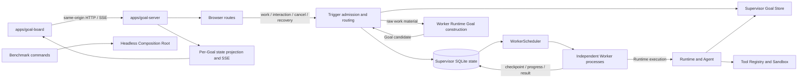

# Goal Server

本机 Web Composition Root，连接 Browser、HTTP、Supervisor、Trigger 持久化与独立 Worker。本文描述当前实现、使用边界与限制；[公开入口](../src/index.ts)。

默认 `lazygoal web` 入口把 Goal Board 的创建与控制命令交给 [Trigger Browser Session Port](../src/browser-session-port.ts)。浏览器 Bearer 能力映射为认证 `externalId`；Supervisor 在持久化前校验 Trigger.source 与连接 Actor。所有 Worker-target 消息先经 Supervisor；当前支持的取消、交互与权限决定由 WorkerScheduler 按 Goal 路由，Worker 之间没有直接连接。取消 Trigger 在持久接收前匹配当前 Run，并在路由时复核；过期 Run 保持未路由。`collaboration.requested/result` 仅保留动作标签；payload 与处理行为未定义，Supervisor 不解释额外内容。Supervisor 独占 Goal Store 写入权，并用 SQLite 直接保存不可变 Trigger、独立路由状态和 FIFO 派发队列；重复 Trigger ID 冲突，不回放旧准入结果。Goal Snapshot 发布后，队列插入与 Trigger 路由完成在同一 SQLite 事务提交。启动时清理已排队 Goal 的残留创建意图，并从存储的未路由 work Trigger 继续准入，不等待来源重交；已有冻结 Goal 创建意图优先于当前配置。未冻结的工作在恢复时重新执行模型准入，因为持久化 Actor 不能区分 Browser user 与 external。Worker 重新接管后，Supervisor 还会尝试原样路由当前状态允许的取消、交互、权限决定和 checkpoint resume；交互回答须匹配 Goal、replyTo 与当前等待，并在 Runtime 应用且 Snapshot 保存后标记路由。checkpoint resume 以 replyTo 关联已记录的 lifecycle.exited，并要求显式确认未知副作用。不适用的事件保留未路由，协作 payload 仍不解释。独立 Worker 进程推进获派 Goal，检查点、进度、交互、取消和生命周期报告经 Trigger 与 Supervisor 协调。列表、会话状态及实时流都按 Goal 查询，不把单个活动 Goal 当作全局状态。

Web 创建 work Trigger 前，Supervisor Adapter 将原始文本摘要为简短 `name`；该名称只用于识别，不替代 `{ kind: "text", text }` material。摘要失败或为空时不会持久化 Trigger，同一来源创建命令仍可重试。控制事件使用由程序确定的名称；Trigger 只记录创建时的 `sentAt`，不另存接收或完成时间。

浏览器入口支持创建 Goal、结构化交互、停止运行和对明确待恢复记录的恢复。普通后续消息、Steer 与消息队列控制返回不支持；已有运行快照保留原样，不自动接回旧 Runtime 会话，也不因缺少 Worker 恢复记录而重新执行。恢复运行中检查点要求用户明确承认最后动作可能产生了未知外部效果。

Worker 遇到 Action 审批时由 [WorkerScheduler](../src/runtime/worker-scheduler.ts) 根据已持久化的 Goal 等待创建权限请求 Trigger。Supervisor 直接调用配置的模型 Adapter，并先核对工具 ID 与实际沙箱范围仍在 Goal 冻结上限内；批准只生成针对当前 Action 的一次性回复。模型失败、输出无效或范围缺失时请求保持待处理并记录失败原因。用户回复与自动回复都要匹配同一请求、Run、Action、提交修订和 Worker generation；Worker Runtime 应用决定后，Scheduler 才原子结算请求与回复。

## 职责与使用

通过本模块的公开入口使用上述能力；[公开入口](../src/index.ts)。状态或副作用由调用方在所属边界控制。

## 边界与限制

本模块不替代其依赖模块的协议或持久化职责；具体输入、失败语义与类型以链接的源码契约为准。

## 内部 Runtime 会话入口

`RuntimeComposition.sessions` 仍提供仓库内部的通用 Runtime 会话能力；默认 Goal Board HTTP 入口不通过它创建或续聊 Goal，而使用前述 Trigger Browser Session Port。

无界面装配在 `RuntimeComposition.sessions` 暴露内部会话操作（`SessionManager`），由 `@lazygoal/runtime` 的会话所有者与命令、Runner、提交器和生命周期共用同一 Store 与提交边界：

- `sessions.create` 先持久化 Goal、首条用户消息、Run 与受理收据，再返回句柄并以被生命周期追踪的后台任务推进首个 Run；返回不等待 Run 完成，首次保存失败不会调用模型或工具。
- `session.send`／`consume`／`events`／`read`／`getInput`／`detach` 委派同一状态所有者；`sessions.query` 是同一执行链上的单消息封装。
- `lifecycle.close()` 先停止会话订阅、输入消费与提交核对任务，再按期限结算后台执行与自有资源；未结算时抛出 `SessionManagerCloseError`，不报告安全关闭。
- 该入口是仓库内调用边界，不是对外稳定的 SDK API；默认装配位置、环境解析、工具与预算语义保持不变。

Headless Composition Root 继续使用同一 Runtime 执行链（Launcher、Coordinator、Runner、共享提交器与工具授权）装配 Benchmark Episode，不迁移默认装配、不重写评分器；会话能力通过同一 Runtime 模块提供，Benchmark 的单次运行与观察边界保持不变。

## 宿主审批预检与恢复决定

无界面宿主通过 `RuntimeComposition.interactions.attach` 注册处理函数。工具审批处理函数会收到只读 `review` 入口：宿主可先对同一工具的拟修订参数调用该入口，取得原参数、最终参数、实际能力范围与审阅引用，再返回绑定该引用的修订决定；宿主不得把未审阅的参数直接交给执行器。`onActionRecovery` 单独处理结果未知的等待，其请求携带本次恢复身份，宿主据此返回明确的重执行或拒绝决定；普通审批处理函数不会收到恢复请求。

注册、读取与预检都不触发历史任务执行，也不创建任何授权。

## Web Worker 装配与主流程

## 主流程

1. Web 创建命令校验模型选择并提交以 Trigger ID 标识的工作事件。Supervisor 对显式用户工作走确定性 Fast path；其他来源由 Supervisor 模型决定接受或忽略并选择工作区策略，不得改写 Trigger 中的原始工作文本。
2. 对已接受的工作 Trigger，Worker Runtime 使用原始 material 和自己的 Profile、Prompt Bundle、上下文协议及执行策略构造 Goal。Supervisor 加入来源与授权上限，持久化 Goal Snapshot 后再写入 FIFO Worker 队列、标记原 Trigger 已路由并发布 `response.goal_created`。准入故障保留未路由 Trigger 及失败分类；Goal ID 冲突不会覆盖现有快照。
3. WorkerScheduler 按派发顺序为 Goal 选择匹配的空闲 Worker，或启动独立进程；不同 Goal 可并行。Supervisor 是 Goal Snapshot 的唯一写入者，Worker Snapshot 经 Supervisor 持久化；Run 的 `running` 进度在对应 Snapshot 保存后发布，`waiting` 与终态响应在 Worker 报告且 Snapshot 核对后发布。所有 Run 响应以 `replyTo` 关联创建该 Goal 的 work Trigger；完成响应的 `answer` 取自已持久化的最终助手答复，失败与取消响应只暴露 `runId`。
4. 结构化回答、取消、权限请求与恢复决定都绑定 Goal、Run、请求身份及必要的 Worker generation，经 Trigger 往返。取消在接收和路由时核对当前 Run；checkpoint resume 绑定对应的 Worker 退出 Trigger。未知工具副作用只有用户明确确认恢复后才可能重试。
5. Supervisor 重启时先清理已入队 Goal 的残留创建意图、补发缺失的创建响应，并重试存储中的未路由新 Goal work Trigger；这不依赖来源重新提交。随后核对所有权和存活 Worker、处理离线积压，再尝试路由仍适用于当前 Goal/Worker 状态的已存储控制 Trigger；不凭 PID 或超时重派未知动作，只有确认退出的 Worker 才形成显式恢复记录。
6. Browser 从 Supervisor 保存的 Goal 与 Trigger 状态构造列表和详情，窄会话 HTTP 与 Goal SSE 的控制快照由一次 Goal Snapshot 读取投影。Goal SSE 初始发送 `state_sync`，后续按提交修订刷新；断线后重新连接会重新读取权威状态。
7. Benchmark 仍有自己的 Headless Composition Root；Prompt Evaluation 执行、GEPA 与 Harness2 的优化执行入口明确返回不支持，不回退旧执行链。

`RuntimeComposition.interactions` 暴露无界面宿主的窄交互接入：`attach` 打开 Goal 会话并注册按交互种类分派的处理函数，`read` 只读返回当前等待的类型化视图；两者都不需要 HTTP、进程信号或前端，决定仍经统一 `send` 与既有身份、授权和提交规则受理。注册处理器只做一致同步：连接之前已有的历史等待不会被自动回答，宿主显式 `resume` 发现仍需交互时只解锁该请求并把结果交给已注册的处理函数；同一 Goal 已有自动所有者时第二次连接被明确拒绝，解除句柄不取消 Goal。可运行示例见 [headless-interaction-handlers.ts](../examples/headless-interaction-handlers.ts)（`npx tsx apps/goal-server/examples/headless-interaction-handlers.ts`）。

实时事件通过独立的 `execution-stream` Core 旁路发送：它只分配 Goal/Run 内 cursor、执行可见性过滤、增量合并和慢订阅者关闭，不拥有 Goal 状态转换、Trajectory 写入、Provider/Tool 调用或 UI 渲染。Runtime 负责把生命周期和提交边界映射成领域事件；Agent/LLM 负责把模型流归一化后发布；Tool 可选地发布输出分片；Web 服务把事件适配为同源 SSE，前端维护瞬时活动视图，恢复仍以 Snapshot/Trajectory 为准。

## 执行装配组件

`src/runtime/` 提供按职责组织的执行装配：`execution-composition.ts` 接收调用方准备
的 StepExecutor、Profile Registry、Store、工具与可选 Port，内部组合 Launcher、
Runner、InlineScheduler、共享 `TrajectoryCheckpointCommitter` 与 GoalCoordinator，
并只暴露调用方需要的执行与控制命令；目录入口 `src/runtime/index.ts` 不重新导出内部
执行对象。该层不解析配置、不创建模型供应商或默认文件存储、不启动 HTTP、不注册
进程信号，也不接管注入依赖的所有权。

`composition.ts` 提供 `createRuntimeComposition`：在调用方提供的工作区、LazyGoal
Home 与数据目录上装配模型、存储、工具与上下文默认实现，组合执行装配组件与
`RuntimeLifecycle`，并使用同一 Checkpoint Gate、实例控制器与受理边界。它返回执行与
控制命令、只读恢复与查询 Port、`manageGoal`、模型选择协调器以及生命周期与资源集合，
不创建 HTTP 服务、不注册进程信号；`runTrackedOperation` 供宿主把已受理的写操作纳入
同一关闭结算边界。装配同时注入沙箱计划解析器：仅从已核准的 `effectiveScope` 为当前工作区和 Action 重建进程内执行计划，服务重建后的审批恢复使用同一路径，不重新授权或扩大范围。借用依赖不被接管，装配失败时只结算本层自有的受管资源并保留初始故障。

`composition-root.ts` 是无界面装配之上的 HTTP 宿主：创建 HTTP 服务、挂载指标路由与
浏览器访问控制、追加关闭准入中间件，并构造宿主退出协调器。

恢复接线沿用既有 RecoveryReader、Coordinator、Tool replay policy 与模型绑定规则：
重建实例后 `restore` 只读不推进，`resume` 必须匹配 Goal、Run、requestId 与 actionId；
结果未知的 `manual` Tool 只进入等待，不被包装层重试；终态后由显式 `continue` 归档旧
Run 并创建后继 Run。包装层不引入迁移、后继 Run 自动调度或第二套状态真相。

`scripts/check-dependencies.mjs` 以现有依赖门强制这些目录的边界：`src/runtime/` 不得
反向导入宿主 CLI、组合根、Browser/HTTP/Web wire 或 Node HTTP 服务实现，也不得直接
请求进程退出或注册进程信号；`execution-composition.ts` 只能引用现有 Runtime、工具与
执行控制契约。目录之外的调用方必须通过 `src/runtime/index.ts` 入口访问，组件源码与
其消费型测试不得解析到项目内 `dist`/`lib`/`build` 产物。

## 宿主退出与实例关闭

Composition Root 构造 `RuntimeLifecycle` 并把实例 Gate、`ManagedResourceRegistry`、实例 AbortController 交付给它；HTTP 关闭后写请求的拒绝继续读取实例控制器信号，不为关闭另建状态。`HostShutdownCoordinator`（[进程退出适配](../src/process-exit.ts)）幂等地并发执行实例关闭与应用资源清理（HTTP 服务），再经 `ExitPort` 请求退出码 130；实例关闭失败或应用清理失败都会上报，但退出请求始终已发出，`ProcessExitPort` 是本应用直接调用 `process.exit` 的唯一实现。CLI 的 SIGINT 与普通退出路径共用该协调器，关闭不完整时记录 `RuntimeLifecycleIncompleteError` 的原因后仍返回 130。

受管进程（`ProcessManager`）与执行流发布者注册在实例注册表中，随实例关闭结算；HTTP 与浏览器连接由应用自己的关闭流程处理，不注册为 Runtime 自有资源。模型与档案写操作（Provider 档案增删改与激活、模型偏好、权限模式、归档与终态删除）通过 `runTrackedOperation` 纳入同一受理与关闭结算边界；进程信号注册与退出决策不进入 Runtime。

## 受管 Provider 解析

Composition Root 在启动时读取 Home 级 Provider 档案并把激活档案解析为启动连接配置；优先级为"环境变量 → 激活的受管档案 → `config.toml` 回退"，`profileId` 只在启动配置确实来自该档案时才写入默认模型选择。阶段适配器按 `{profileId, modelId}` 构造：选择的 `profileId` 可解析时使用该档案的凭据与端点，不可解析时显式失败并要求重新选择，不回退其它档案或其它供应商。档案变更后 `refreshProviderProfiles()` 刷新运行时解析视图，已发布的模型绑定保持不变；`GoalModelSelection.profileId` 随 Snapshot 持久化且不含凭据，缺失时回退启动配置。

设置页的档案管理由浏览器路由端口实现转发到 `providerProfileStore`；连接测试解析目标档案后只做在线模型列表拉取。

Provider 表单在线查询由 Composition Root 校验供应商和端点规则，并在密钥留空时从指定的同类 Provider 档案读取凭据；未提供档案或供应商不匹配时不得借用其它来源。使用在线 Provider Fetcher 查询真实列表，不调用生成、不补静态目录、不保存表单、不刷新或改变激活档案。错误归一为脱敏的稳定分类。

## 模型目录与动态执行恢复

浏览器选模请求只携带模型 ID 和可选 Profile ID。Goal Server 从当前 Provider 的可选择目录描述生成 `GoalModelSelection`；浏览器目录投影不包含 `executionApi`、执行端点或凭据。显式 CLI 默认模型 ID 可由本机执行登记补齐 Adapter 配置，但该配置路径不宣称模型已通过在线可用性检查。

OpenCode Go 在线文本模型按实时模型元数据确认文本生成、工具调用和容量后可选，并统一通过 `llm-pi-ai` 的 Chat Completions 适配路径执行。`GoalModelSelection` 与 Snapshot 保存协议、容量、推理、视觉和工具选择能力；每次恢复按保存数据构造 Adapter，并按已保存的 Profile ID 解析当前 API Key。端点由 `llm-pi-ai` 固定，API Key 与 Base URL 不写入 Goal 状态。上游可能限制部分免费模型只能在 OpenCode 内调用，外部客户端请求可能收到 403。

[Trigger 准入组件](../src/runtime/trigger-admission.ts) 对显式用户工作使用确定性 Fast path；其他来源由 Supervisor 直接调用模型执行 Slow path。准入失败分类随未路由 Trigger 保存，Supervisor 重启时会直接从该事件恢复处理。默认浏览器入口使用该准入路径。

[独立 Worker](../src/runtime/worker-process.ts) 以 OS 子进程复用执行 Runtime。Goal 快照经 generation 与持久队列绑定核验后由 Supervisor 保存。Worker 将执行检查点和待确认的结果保存在本地 outbox。

对已确认绑定的 Worker，[取消路由](../src/runtime/worker-scheduler.ts)直接派发当前 Run 的取消。正在提交推进或回复命令时，取消等该命令提交后即可发送。原操作槽保留到其结果返回或通信失败。断线且缺少终态证据时，Supervisor 保留持久绑定与未路由 Trigger，供恢复流程核验。

[Worker 调度器](../src/runtime/worker-scheduler.ts) 按持久队列顺序认领 Goal，匹配同一授权工作区的空闲 Worker，需要时启动新进程。等待中的 Goal 保持 Worker 占用。原操作返回、终态 Snapshot 与响应保存、队列提交终态后，Worker 才可复用。取消遇到已完成或失败的 Run 时返回已有终态。

[Goal 工作区管理器](../src/runtime/goal-workspace.ts) 根据准入选择使用共享目录或在干净 Git 项目中创建可恢复的独立 worktree。项目权限身份保持在项目根；合并前需要绑定 Goal、目标分支、head 和变更摘要的用户确认，合并后才清理 worktree。
