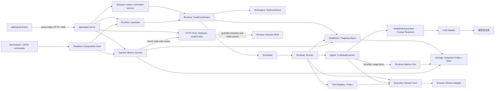

# Goal Server

本机 Web 服务 Composition Root，连接 Runtime、Browser、HTTP 与前端。本文描述当前实现、使用边界与限制；[公开入口](../src/index.ts)。

## 职责与使用

通过本模块的公开入口使用上述能力；[公开入口](../src/index.ts)。状态或副作用由调用方在所属边界控制。

## 边界与限制

本模块不替代其依赖模块的协议或持久化职责；具体输入、失败语义与类型以链接的源码契约为准。

## 服务装配与主流程

## 主流程

1. Launcher 校验 intent、Profile、协议组合和持久化依赖，默认创建普通 Run；GoalPlan 可缺省，也可保留已有计划。
2. `/plan` 为尚未提交 `run_started` 的当前 Run 选择 Plan 模式；当前 Run 已完成或失败时，将一次性选择保存为 `nextRunMode`，由下一 Run 消费。
3. Coordinator 调用统一 Runner。普通 Run 直接处理用户请求；Plan Run 的 Prompt 要求先提出任务提案，但 Runtime 仍按现有 Profile、Tool Policy 和 Action 审批授权已暴露的业务 Tool。Decide 可请求目标明确的 Think；Runner 提交 Think 输出后再调用 Decide，完成候选通过协议与证据校验后，还须独立审查交付与事实支持；接受后才提交回复和完成。只有最终业务决策推进 Step。
4. `ask_user` 与 Plan Run 的 `task_proposal` 都保存为可恢复的 `pendingInteraction`。提案等待期间不继续模型或 Tool 调用；用户回答、批准或反馈持久化后，Coordinator 恢复同一 Run。completed 或 failed 输入先归档历史及终态，再提交新 Run。
5. 获批 Plan Run 可通过受模式能力授权的计划 Tool 更新 GoalPlan。一个 Run 可依次更新多个 Todo；标记 Todo 完成必须引用当前 Run 已提交 Observation。Run 终态独立于未完成 Todo，后者保留原状态且不会自动创建下一 Run。
6. 每个事实、Memory Patch、消息、Action/Observation 和 Snapshot 都遵守“提交成功后才继续”的边界。非 YOLO 工具审批可按单次、当前 Goal 或 workspace 授权；持续授权在 Goal 批准快照提交后才激活。Web 看板从已提交的 Goal、Run 与计划状态投影会话和交互面板。

实时事件通过独立的 `execution-stream` Core 旁路发送：它只分配 Goal/Run 内 cursor、执行可见性过滤、增量合并和慢订阅者关闭，不拥有 Goal 状态转换、Trajectory 写入、Provider/Tool 调用或 UI 渲染。Runtime 负责把生命周期和提交边界映射成领域事件；Agent/LLM 负责把模型流归一化后发布；Tool 可选地发布输出分片；Web 服务把事件适配为同源 SSE，前端维护瞬时活动视图，恢复仍以 Snapshot/Trajectory 为准。

## 执行装配组件

`src/runtime/` 提供按职责组织的执行装配：`execution-composition.ts` 接收调用方准备
的 StepExecutor、Profile Registry、Store、工具与可选 Port，内部组合 Launcher、
Runner、InlineScheduler、共享 `TrajectoryCheckpointCommitter` 与 GoalCoordinator，
并只暴露调用方需要的执行与控制命令；目录入口 `src/runtime/index.ts` 不重新导出内部
执行对象。该层不解析配置、不创建模型供应商或默认文件存储、不启动 HTTP、不注册
进程信号，也不接管注入依赖的所有权。

`composition.ts` 提供 `createRuntimeComposition`：在调用方提供的工作区、LazyGoal
Home 与数据目录上装配模型、存储、工具与上下文默认实现，组合执行装配组件与
`RuntimeLifecycle`，并使用同一 Checkpoint Gate、实例控制器与受理边界。它返回执行与
控制命令、只读恢复与查询 Port、`manageGoal`、模型选择协调器以及生命周期与资源集合，
不创建 HTTP 服务、不注册进程信号；`runTrackedOperation` 供宿主把已受理的写操作纳入
同一关闭结算边界。借用依赖不被接管，装配失败时只结算本层自有的受管资源并保留初始故障。

`composition-root.ts` 是无界面装配之上的 HTTP 宿主：创建 HTTP 服务、挂载指标路由与
浏览器访问控制、追加关闭准入中间件，并构造宿主退出协调器。

恢复接线沿用既有 RecoveryReader、Coordinator、Tool replay policy 与模型绑定规则：
重建实例后 `restore` 只读不推进，`resume` 必须匹配 Goal、Run、requestId 与 actionId；
结果未知的 `manual` Tool 只进入等待，不被包装层重试；终态后由显式 `continue` 归档旧
Run 并创建后继 Run。包装层不引入迁移、后继 Run 自动调度或第二套状态真相。

`scripts/check-dependencies.mjs` 以现有依赖门强制这些目录的边界：`src/runtime/` 不得
反向导入宿主 CLI、组合根、Browser/HTTP/Web wire 或 Node HTTP 服务实现，也不得直接
请求进程退出或注册进程信号；`execution-composition.ts` 只能引用现有 Runtime、工具与
执行控制契约。目录之外的调用方必须通过 `src/runtime/index.ts` 入口访问，组件源码与
其消费型测试不得解析到项目内 `dist`/`lib`/`build` 产物。

## 宿主退出与实例关闭

Composition Root 构造 `RuntimeLifecycle` 并把实例 Gate、`ManagedResourceRegistry`、实例 AbortController 交付给它；HTTP 关闭后写请求的拒绝继续读取实例控制器信号，不为关闭另建状态。`HostShutdownCoordinator`（[进程退出适配](../src/process-exit.ts)）幂等地并发执行实例关闭与应用资源清理（HTTP 服务），再经 `ExitPort` 请求退出码 130；实例关闭失败或应用清理失败都会上报，但退出请求始终已发出，`ProcessExitPort` 是本应用直接调用 `process.exit` 的唯一实现。CLI 的 SIGINT 与普通退出路径共用该协调器，关闭不完整时记录 `RuntimeLifecycleIncompleteError` 的原因后仍返回 130。

受管进程（`ProcessManager`）与执行流发布者注册在实例注册表中，随实例关闭结算；HTTP 与浏览器连接由应用自己的关闭流程处理，不注册为 Runtime 自有资源。模型与档案写操作（Provider 档案增删改与激活、模型偏好、权限模式、归档与终态删除）通过 `runTrackedOperation` 纳入同一受理与关闭结算边界；进程信号注册与退出决策不进入 Runtime。

## 受管 Provider 解析

Composition Root 在启动时读取 Home 级 Provider 档案并把激活档案解析为启动连接配置；优先级为"环境变量 → 激活的受管档案 → `config.toml` 回退"，`profileId` 只在启动配置确实来自该档案时才写入默认模型选择。阶段适配器按 `{profileId, modelId}` 构造：选择的 `profileId` 可解析时使用该档案的凭据与端点，不可解析时显式失败并要求重新选择，不回退其它档案或其它供应商。档案变更后 `refreshProviderProfiles()` 刷新运行时解析视图，已发布的模型绑定保持不变；`GoalModelSelection.profileId` 随 Snapshot 持久化且不含凭据，缺失时回退启动配置。

设置页的档案管理由浏览器路由端口实现转发到 `providerProfileStore`；连接测试解析目标档案后只做在线模型列表拉取。

Provider 表单在线查询由 Composition Root 校验供应商和端点规则，并在密钥留空时从指定的同类 Provider 档案读取凭据；未提供档案或供应商不匹配时不得借用其它来源。使用在线 Provider Fetcher 查询真实列表，不调用生成、不补静态目录、不保存表单、不刷新或改变激活档案。错误归一为脱敏的稳定分类。
