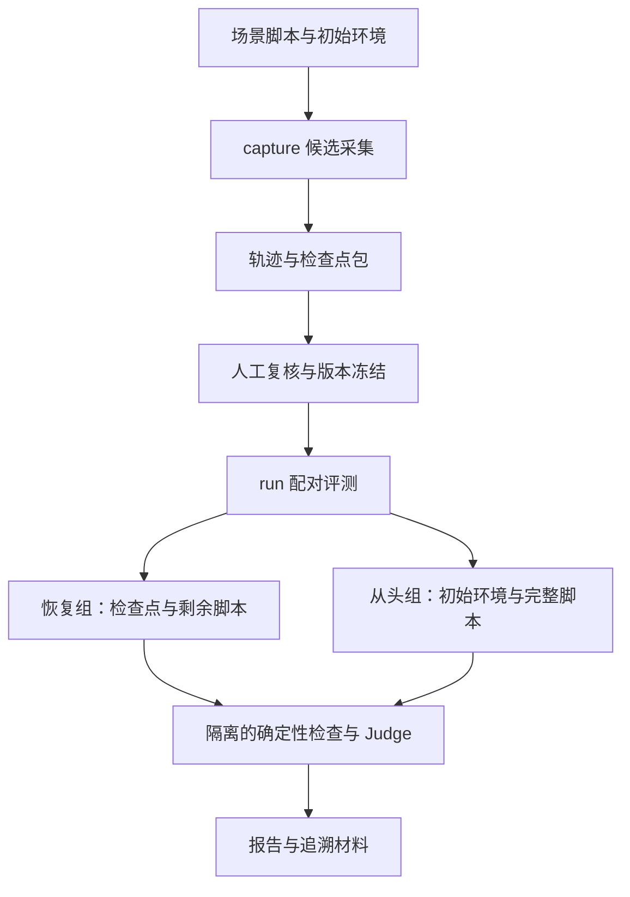

# Context Benchmark 自动化底座 Spec

## 目标与范围

建立 LazyGoal 原生 context benchmark 底座，让同一个冻结用例能够自动采集、复核入库、恢复续接、跨 Run 执行和评分。程序按预设脚本扮演用户，通过真实 Runtime 入口注入消息，不要求操作者在每个 Run 结束后输入 prompt。

首期包含两个执行入口：`capture` 使用显式配置的采集模型生成候选轨迹与检查点；`run` 使用显式配置的执行模型，在 Docker 中执行冻结用例，自动完成脚本推进、确定性检查、独立 LLM Judge 和报告。候选经人工复核后才可进入冻结的核心集或挑战集。冻结与复核操作属于用例管理，不增加第三套执行引擎。

`run` 支持配对评测：一组从冻结检查点恢复并执行剩余脚本，另一组从初始环境执行完整脚本。两组使用相同执行模型、Agent Profile、预算政策和评分版本；各自保留实际环境与上下文来源。报告用于比较恢复后表现及成本，不声称能够单独证明 context 的因果贡献。

首期只提供证明底座可用的少量验证场景，覆盖自动跨 Run、检查点恢复、评分隔离及失败处理。不建设此前讨论的八类任务库，不要求每类正反例。后续新增任务沿用同一用例契约。

不包含公开 benchmark 数据集适配、GEPA 优化、动态生成续接 prompt、自动入库或晋升用例、常驻调度服务、评测管理 Web 界面，以及历史 Snapshot 迁移。底座不修改 Runtime 的 context 语义，不重新引入语义压缩模型或后台 context sidecar。

## 需求与验收标准

### 需求 1：固定脚本驱动真实生命周期

作为评测维护者，我希望预先声明用户交互和触发条件，以便无需人工逐轮输入也能重复执行跨 Run 场景。

- **验收标准 1.1**：当启动一个用例时，系统应当读取运行前已冻结的初始 prompt、后续 prompt、触发条件、阶段顺序和执行预算；每次注入应当记录脚本步骤、实际消息、触发事件和对应 Run。
- **验收标准 1.2**：当当前 Run 到达步骤声明的终态时，系统应当通过 `GoalCoordinator.continue` 将下一段 prompt 作为用户消息持久化，并在同一 Goal 内创建下一 Run，保留既有历史、工作记忆与文件状态。
- **验收标准 1.3**：当脚本声明等待用户回答且 Run 进入相符的 waiting 状态时，系统应当通过 `GoalCoordinator.resume` 提交预设回答并继续同一 Run；系统应当按 Runtime 的等待类型校验入口适用性，不把 resume 当作 continue。
- **验收标准 1.4**：若状态、等待类型或阶段顺序不符合脚本，系统应当停止推进并记录差异；若超过阶段、时长或调用预算，系统应当取消执行并记录预算终止原因，不追加模型生成的补救 prompt。
- **验收标准 1.5**：当脚本预期前一 Run 失败后重试时，系统应当允许该失败触发下一阶段，并按完整场景判据评分；单个预期失败 Run 不应当自动使整个用例失败。

### 需求 2：候选采集与可恢复检查点

作为评测维护者，我希望保存真实执行的恢复边界及其环境，以便评测不依赖事后猜测上下文。

- **验收标准 2.1**：当执行 `capture` 时，系统应当使用显式采集模型配置，在固定 Docker 初始环境中运行脚本，保存候选结果、已提交轨迹、完整模型输入和声明位置的检查点；采集成功不应当自动构成用例入库或正确性证明。
- **验收标准 2.2**：当保存检查点时，系统应当在声明的已提交、静止边界保存当时的 Goal Snapshot、恢复所需历史及工作区文件状态；保存期间不得存在未完成工具副作用或活动任务子进程。首期支持脚本阶段之间的终态边界及 waiting 边界，不支持任意执行中断点。
- **验收标准 2.3**：当复用检查点时，系统应当校验清单、文件哈希、容器镜像身份、运行协议及当前持久化契约，重建隔离环境和 Worker 进程后通过 Runtime 恢复；若材料缺失、损坏或不受支持，应当明确拒绝评测，不重新采集并替换检查点。
- **验收标准 2.4**：当采集轨迹不能在指定位置达到安全边界时，系统应当保存采集失败诊断，且不发布可用检查点；系统不得从最终 Snapshot 和日志反推历史 Snapshot。

### 需求 3：人工复核与冻结版本

作为用例审核者，我希望审核材料和判据后再发布版本，以便 benchmark 演化不会悄悄改变结论。

- **验收标准 3.1**：当提交候选供复核时，系统应当提供脚本、环境、检查点、轨迹来源、确定性判据、Judge rubric 和已知限制；若必须材料或可执行判据缺失，应当阻止入库。
- **验收标准 3.2**：当人工明确批准并冻结用例时，系统应当记录批准人、时间与所批准内容的哈希，将用例纳入核心集或挑战集的版本清单；对 prompt、检查点、判据或 rubric 的修改应当产生新的内容身份和待复核候选。
- **验收标准 3.3**：当运行冻结集时，系统应当核对内容哈希并在报告中记录集合版本与用例身份；若文件被改动，应当拒绝运行该版本，不以同一版本名覆盖结果。用例从挑战集晋升核心集应当经过新的人工批准。

### 需求 4：恢复续接与从头执行配对评测

作为 context 维护者，我希望在相同执行配置下比较两种路径，以便观察恢复后的可靠性与资源消耗。

- **验收标准 4.1**：当执行冻结用例的 `run` 时，系统应当为恢复组和从头执行组创建独立容器与持久化目录；恢复组导入冻结检查点并执行剩余脚本，从头执行组从固定初始环境执行完整脚本，两组不得共享可变文件或运行状态。
- **验收标准 4.2**：当构建配对结果时，系统应当固定执行模型、Profile、预算政策、初始材料、脚本版本和评分版本，记录采集模型与检查点来源；若配置不一致，应当将结果标记为不可配对并说明差异。
- **验收标准 4.3**：当报告资源指标时，系统应当分别呈现恢复组的续接成本、从头组的完整成本和候选采集成本；报告应当保留每组实际调用与阶段数据，不将采集成本混入执行成本，也不把不同前缀环境视为相同。
- **验收标准 4.4**：当一组失败或中断时，系统应当保留另一组结果及双方状态；报告应当给出计划、尝试、完成、未完成和可配对数量，不只展示成功完成的样本。

### 需求 5：确定性检查与独立 Judge

作为评测使用者，我希望程序验证实际行为并由独立 Judge 评估解释，以便模型自述不成为完成依据。

- **验收标准 5.1**：当评测开始前，系统应当固定可执行判据与 Judge rubric；结束后应当检查实际文件、测试结果、生命周期状态和用例声明的证据约束，并保留逐项检查结果。
- **验收标准 5.2**：当调用 Judge 时，系统应当使用与采集、执行分别显式配置的 Judge 角色，基于隔离的 rubric、输出与审核证据评估解释质量，保存模型配置、请求与响应、评分依据及用量。角色独立不要求使用不同模型产品。
- **验收标准 5.3**：若确定性检查失败或发生证据隔离违规，系统应当判定综合验收不通过；Judge 高分不得覆盖该结果。综合通过应当同时满足确定性检查与冻结 rubric 的 Judge 门槛。
- **验收标准 5.4**：若 Judge 请求失败、评分格式无效或必要证据缺失，系统应当标记评分未完成并保留已有确定性结果，不按零分或通过处理；缺失的用量应当标记不可用，不填为零。
- **验收标准 5.5**：当执行 agent 工作时，后续 prompt、隐藏判据、预期答案和 Judge rubric 应当留在宿主评测侧；确定性 verifier 应当在 agent Worker 和其子进程停止后，由独立评测进程运行。Judge 和 verifier 不应当修改被评产物来使其通过。

### 需求 6：可追溯自动运行与验证

作为维护者，我希望一条命令自动完成冻结集评测，并保留足以解释结果的材料。

- **验收标准 6.1**：当执行 `capture` 或 `run` 时，系统应当沿用共享 benchmark 环境、Worker、LLM RPC、记录与持久化设施；代码和 shell 执行应当发生在 Docker 中，容器不应当获得宿主凭据或可写项目挂载，模型调用通过宿主 RPC 完成。
- **验收标准 6.2**：当保存执行结果时，系统应当记录实际加载的 Worker 与内嵌 prompt 身份、源构建摘要、模型及 Profile 配置、预算政策、镜像身份、脚本、集合、rubric 和判据哈希，以及 Goal/Run 与模型输入索引。未提交源码应当反映在构建摘要中，仅记录 Git HEAD 不足以识别执行版本。
- **验收标准 6.3**：当自动执行结束、取消或发生基础设施错误时，系统应当关闭 Worker、模型 RPC 和容器并保留诊断；任务行为失败、脚本不匹配、评分未完成及基础设施错误应当在报告中分别可识别，不全部归为同一失败原因。
- **验收标准 6.4**：当生成报告时，系统应当提供机器可读结果与可阅读摘要，分别展示确定性结果、Judge 结果、综合通过率、脚本推进情况、context 违规及资源指标；上下文暴露、检索命中或模型引用应当作为观测证据，不自动证明模型实际使用了该信息。
- **验收标准 6.5**：当交付底座时，验证应当包含离线契约测试、真实 Docker 全流程和真实模型端到端证据，证明固定 prompt 自动跨 Run、重建 Worker 后的等待恢复、配对隔离与评分链路；还应当验证状态不匹配、检查点损坏、判据失败不能被 Judge 覆盖、Judge 不可用及隐藏材料隔离。真实模型验证应当记录实际配置与结果，不能用离线替身代替交付证据。

## 架构与核心决策

### 系统拓扑与职责

`benchmarks/context/` 拥有场景脚本、候选、冻结清单、配对编排、评分和报告。共享 `benchmarks/src/` 继续拥有 Headless 组装、Docker 环境、Worker 构建、LLM RPC 和 AttemptRecorder。具体 benchmark 不从其他 benchmark 目录横向导入实现。

现有 `HeadlessCompositionRoot.run(task)` 以新 Goal、新 Run 为单位组装并清理执行环境，不能直接承担保留会话的多阶段编排。共享层提供满足当前需求的会话组装与关闭边界，复用 Runner、Coordinator 和持久化端口；context runner 在会话存活期间驱动脚本，不复制 Runtime 状态机。既有单任务 benchmark 继续使用其正常单 Run 路径。

| 契约 | 必须保存或声明的内容 | 所有者 |
| --- | --- | --- |
| 场景定义 | 稳定身份、初始环境、固定消息、阶段与触发条件、预算、检查点位置、判据及 rubric 引用 | `benchmarks/context/` |
| 检查点包 | 当时完整 Snapshot、所需 committed histories、文件归档、模型输入、镜像与内容哈希、剩余脚本位置、采集来源 | `benchmarks/context/` |
| 冻结清单 | 集合及版本、用例内容身份、人工批准记录、核心集或挑战集归属 | `benchmarks/context/` |
| 执行身份 | 实际 Worker、源码摘要、内嵌 prompt、模型、Profile、预算、镜像及判据版本 | 共享执行记录与 context 结果 |
| 配对结果 | 两组运行索引、阶段轨迹、检查结果、Judge 记录、用量、完成状态及可配对性 | `benchmarks/context/` |

具体字段及 CLI 参数由当前命令分发和类型契约定义。评测输出沿用 LazyGoal Home 的 workspace-scoped benchmark 目录与共享持久化规则，Goal/Run 路径沿用 base64url 标识，不新建宿主全局状态服务。

### 核心决策

- **用户交互由固定脚本驱动**：消息保持用户身份，通过 Coordinator 入口持久化；终态续接和等待回答分别对应 continue 与 resume。状态触发不依赖固定睡眠，也不以模型解释替代实际 Runtime 状态。
- **检查点只在安全边界捕获**：在提交成功后且下一阶段尚未启动时暂停编排，确认静止并保存环境。Snapshot 为恢复权威，trajectory 为历史证据；不把模型输入诊断或日志变成恢复状态。
- **复用当前 context 管线**：Headless 会话接入真实 Context Lookup Port 与 ModelInputStore，lookup 读取同一 Goal 的已提交历史；文件读取仍是工具行为。恢复后按正常组装生成模型输入，不直接回放教师的旧请求文本。
- **采集与评测分离**：高级采集模型提供候选执行，不提供自动金标准。判据由场景作者声明并在入库时复核；真实评测前冻结内容，不能根据本次结果反向调节门槛。
- **配对结果保留来源差异**：教师检查点与从头组自行执行的前缀可能形成不同产物与历史，报告明确呈现差异。配对主要用于恢复表现与成本参照，不把它包装为严格的 context 消融实验。
- **确定性检查与 Judge 分开**：确定性检查决定实际产物与约束是否满足，Judge 评估开放式解释。二者逐项保留，综合通过采用同时满足；评分不可用保留为未完成。
- **构建身份来自实际执行材料**：Worker 使用内嵌 prompt。记录实际构建摘要及容器身份，避免当前源码、运行中的旧 Worker 与报告标注版本不一致。
- **沿用共享记录生命周期**：不为 context 评分重写共享 AttemptRecorder 状态；评分完整性、脚本差异及 context 违规进入 benchmark 领域结果。核心集与挑战集是可复核的内容版本，不是 Runtime 协议版本。

## 曾考虑的备选方案

- **先建设八类完整任务库**：能更快扩大覆盖面。**落选原因**：本期目标已调整为底座，任务设计暂缓；先验证捕获、恢复与评分契约，避免任务数量掩盖设施缺陷。
- **每段续接由人工输入**：实现简单。**落选原因**：输入与时机难以重复，无法无人值守执行冻结场景。
- **模型动态生成下一段 prompt**：可以根据上一步结果灵活调整。**落选原因**：改变被测任务和难度，削弱版本间可比性，也可能把评分线索泄漏到执行上下文。
- **直接重复调用单任务 Headless 入口**：共享代码改动较少。**落选原因**：每次新建会话并清理环境，不能保持同一 Goal 的跨 Run 历史或真实等待恢复。
- **从完整轨迹重建历史 Snapshot**：减少捕获时的设施改动。**落选原因**：日志不具备完整恢复权威，无法保证 Snapshot 与工具副作用对应同一时刻。
- **只跑恢复组或将教师轨迹当作答案**：成本较低。**落选原因**：缺少从头执行参照；教师输出也可能包含错误或偶然成功，不能替代产物判据。
- **只用确定性检查或只用 Judge**：单一评分链更简单。**落选原因**：前者不足以覆盖开放式解释，后者不能可靠替代文件、测试与证据边界检查；本期采用分别配置和记录的两类评分。
- **采集后自动入库、自动晋升**：提高候选周转速度。**落选原因**：错误判据或泄漏可能被持续放大，且改变集合含义；本期保留明确人工复核。
- **为每个场景克隆 Runtime 或新增 context 服务**：可在 benchmark 内自由控制细节。**落选原因**：测到的将是另一套生命周期；复用当前 Runtime 和共享组装即可满足需求。

## 风险与否定性保证

- **环境一致性风险**：文件归档不能覆盖任意外部服务、运行进程或机器状态。首期限定本地 Docker 项目和静止边界，明确拒绝材料不完整的检查点，不宣称支持任意时刻恢复。
- **模型波动与教师来源差异**：固定配置不能保证输出相同，教师检查点可能比执行模型自行生成的前缀更优。保留逐组证据、来源及样本数量，不以一次成功宣称稳定提升。
- **Judge 偏差**：独立配置不能消除判断偏差。冻结 rubric、要求可核对的依据、保存原始评分记录，并允许人工审计；Judge 不覆盖确定性失败。
- **成本风险**：配对执行、采集和 Judge 均消耗模型额度。各角色显式配置并使用阶段及执行预算，分别报告用量；本期不增加后台循环或自动重复采样服务。
- **内容身份与隐私**：归档可能包含任务文件和模型输入。限定受控测试材料，凭据由宿主 RPC 管理，不导入真实用户宿主项目或秘密；报告可追溯身份不包含凭据值。
- **否定性保证**：未经人工复核的候选不得进入冻结集合；同一冻结版本不得原地修改；执行 agent 不得提前访问未来消息、隐藏判据或 Judge rubric；无效检查点不得静默重采集；非预期状态不得由动态 prompt 自动修补；失败和未完成样本不得从报告分母消失。
- **实现边界**：不放宽 working-memory 证据校验，不静默丢弃非法 patch，不新增历史数据兼容层，不把检索命中率等同于 context 整体质量。拥有模块的 README、overview 和 semantics 与实现同步，文档、依赖边界及相关测试已验证。
