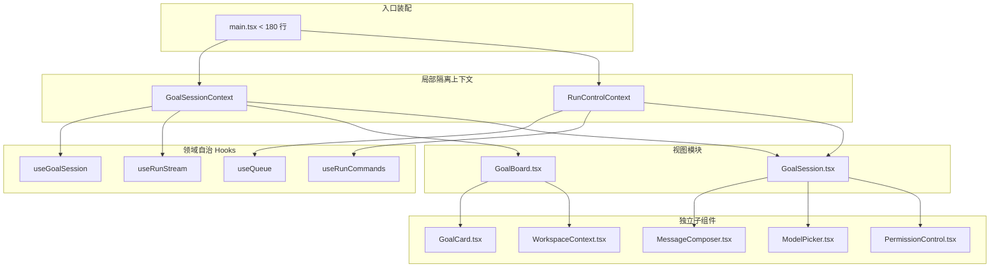

# Goal 看板前端架构重构 Spec

## 目标与范围

### 业务目标与价值

对 LazyGoal 浏览器前端应用（`@lazygoal/goal-board`）的上帝文件 [`apps/goal-board/src/main.tsx`](../../apps/goal-board/src/main.tsx)（约 2000 行 / 99KB）进行模块化架构重构。将内联杂糅的展示组件、异步网络流、排队状态机及交互控制逻辑拆分为单职责的组件与领域 Hooks，彻底消除巨型文件与全树重复渲染隐患，提高可维护性与测试内聚度。

### 核心范围 (In-Scope)

1. **子组件物理抽离**：将内联定义在 `main.tsx` 中的展示与表单组件物理抽离至 `apps/goal-board/src/components/`：
   - `GoalCard.tsx`（会话卡片与指标展示）
   - `ModelPicker.tsx`（模型选择弹窗面板）
   - `MessageComposer.tsx`（输入草稿、快捷键处理、排队标签）
   - `PermissionControl.tsx`（执行审批交互项与按钮组）
   - `WorkspaceContext.tsx`（工作区上下文信息展示）
2. **主视图模块解耦**：将看板列表与会话主视口拆分为独立模块：
   - `GoalBoard.tsx`（看板全量会话卡片流、状态筛选与新建交互）
   - `GoalSession.tsx`（单会话主交互区、时间轴、实时流式输出视口与底部控制台）
3. **自治领域 Hooks 抽离**：将网络流与状态流抽离至 `apps/goal-board/src/hooks/`：
   - `useRunStream.ts`（SSE 实时流订阅、连接生命周期管理、增量文本打字机与活动事件缓冲聚合）
   - `useGoalSession.ts`（Goal 快照加载、只读刷新调度与草稿态会话管理）
   - `useQueue.ts`（客户端消息队列、有限状态机流转与单飞锁 In-flight Lock 防重防竞态机制）
   - `useRunCommands.ts`（Steer 输入引导、Interrupt 中断、Resume 恢复与 Interaction 调用的统一分发与忙碌降级）
4. **局部 Context 状态隔离**：在 `apps/goal-board/src/context/` 建立精细隔离的局部 Context：
   - `GoalSessionContext`（管理活动 Goal 状态、快照与时间轴视图上下文）
   - `RunControlContext`（管理指令分发、排队状态机与当前运行锁）
5. **顶层入口收敛**：`apps/goal-board/src/main.tsx` 仅保留根应用装配、上下文 Provider 嵌套及顶层布局，代码体量收敛至 180 行以内。
6. **文档同步更新**：同步更新 `apps/goal-board/README.md`、`notes/overview.md` 和 `notes/semantics.md`，并通过 `npm run check:docs`。

### 明确不包含的边界 (Non-Goals)

1. **协议与后端零改动**：不修改后端 HTTP API 路由、SSE 事件契约格式、持久化快照结构或任何服务端逻辑。
2. **零视觉与交互变更**：现有 UI 视觉样式、DOM 几何排版、CSS 类名、交互响应逻辑保持 100% 等价保真，不引入任何视觉改造。
3. **零新增外部依赖**：不引入 Redux、Zustand、MobX 等第三方状态库，全流程依赖 React 19 原生 Hooks 与 Context。

---

## 需求与验收标准

### 需求 1：功能与交互行为 100% 等价保真

作为使用 Web 看板交互的用户与开发者，我希望重构后的前端在所有交互功能与视觉呈现上保持完全一致，以便在架构模块化的同时不破坏任何既有使用体验与测试基线。

- <a id="spec-req-1-1"></a>**验收标准 1.1**：当用户在 Goal 看板进行会话卡片切换、搜索过滤、归档状态切换、新建 Goal 及删除会话操作时，系统的视图响应、状态更新与视觉布局必须与重构前严格一致。
- <a id="spec-req-1-2"></a>**验收标准 1.2**：当活动 Run 产生 SSE 流式输出、工具执行状态变更或完成提交时，系统实时打字机文本追加、动态提示标签及完成态收敛行为必须保持严格等价。
- <a id="spec-req-1-3"></a>**验收标准 1.3**：当用户触发 Steer 输入引导、Interrupt 中断、Resume 恢复或交互审批指令时，按钮使能禁用逻辑、忙碌状态展示及错误回退处理必须与重构前完全一致。
- <a id="spec-req-1-4"></a>**验收标准 1.4**：当用户切换至 Trajectory 标签页或在活动记录中点击特定执行单元时，系统的轨迹聚焦定位与历史复盘联动行为必须完全保真。

### 需求 2：顶层入口收敛与视图组件物理剥离

作为前端代码维护者，我希望 `main.tsx` 仅承担顶层装配与全局上下文职责，以便消除 2000 行巨型上帝文件并清晰理解组件拓扑。

- <a id="spec-req-2-1"></a>**验收标准 2.1**：原本内联定义在 `main.tsx` 中的子组件（`GoalCard`、`ModelPicker`、`MessageComposer`、`PermissionControl`、`WorkspaceContext` 等）必须物理剥离至 `apps/goal-board/src/components/` 独立文件中，无内联残留。
- <a id="spec-req-2-2"></a>**验收标准 2.2**：看板列表主视图（`GoalBoard.tsx`）与会话主视口（`GoalSession.tsx`）必须物理拆分为独立业务组件模块。
- <a id="spec-req-2-3"></a>**验收标准 2.3**：重构后的 `main.tsx` 代码行数必须严格收敛至 180 行以内。
- <a id="spec-req-2-4"></a>**验收标准 2.4**：剥离后的视图组件必须严格保留现有的 DOM 结构层级与 CSS 类名定义，严禁引入改变几何排版的不必要包裹标签（div wrappers）。

### 需求 3：运行时状态机与网络流抽离为自治领域 Hooks

作为系统架构师，我希望将散落在 UI 中的异步流与状态机封装为内聚自治的领域 Hooks，以便实现视图层与领域控制层的彻底解耦。

- <a id="spec-req-3-1"></a>**验收标准 3.1**：系统必须提供独立的 `useRunStream` Hook，自治维护 SSE 连接生命周期、断线重连及打字机缓冲聚合。
- <a id="spec-req-3-2"></a>**验收标准 3.2**：系统必须提供独立的 `useGoalSession` Hook，自治管理活动 Goal 快照加载、只读刷新调度与草稿态会话维护。
- <a id="spec-req-3-3"></a>**验收标准 3.3**：系统必须提供独立的 `useQueue` Hook，自治管理输入排队列表、有限状态机流转及具备单飞锁（In-flight Lock）防重防死锁机制。
- <a id="spec-req-3-4"></a>**验收标准 3.4**：系统必须提供独立的 `useRunCommands` Hook，统一承载 Steer、Interrupt、Resume 及 Interaction 调用的忙碌标记与错误降级。

### 需求 4：轻量局部状态治理与零第三方新依赖

作为项目维护者，我希望前端架构遵循轻量化与高内聚原则，以便避免过度设计和无谓的打包体积膨胀。

- <a id="spec-req-4-1"></a>**验收标准 4.1**：跨组件状态共享必须完全基于 React 原生能力（自定义 Hooks、`useReducer` 状态机与局部 `Context`）组织，禁止引入 Redux、Zustand 等第三方状态库。
- <a id="spec-req-4-2"></a>**验收标准 4.2**：状态上下文必须按职责细分为 `GoalSessionContext` 与 `RunControlContext`，严禁将所有正交状态集中在单一大 Context 中造成全树重复渲染。

### 需求 5：测试安全网全程保全与文档同步校验

作为质量保证工程师，我希望重构全流程具备自动化测试安全网防护，并在完成后同步更新模块文档。

- <a id="spec-req-5-1"></a>**验收标准 5.1**：重构实施过程中必须持续全绿通过现有单元测试与 E2E 测试（`node --test apps/goal-board/e2e/*.test.mjs`），不跳过、删减或弱化现有测试断言。
- <a id="spec-req-5-2"></a>**验收标准 5.2**：重构完成后，`apps/goal-board/README.md`、`notes/overview.md` 和 `notes/semantics.md` 必须准确反映新的目录结构、职责边界与权威概念映射，并通过 `npm run check:docs` 校验。

---

## 架构与核心决策

### 系统拓扑与目录结构

重构后的模块拓扑结构如下：

```text
apps/goal-board/src/
├── components/                  # 视图与展示子组件
│   ├── GoalBoard.tsx           # 看板全量会话主视图
│   ├── GoalSession.tsx         # 会话主视口（时间轴/流式输出/控制台）
│   ├── GoalCard.tsx            # 会话卡片与指标展示
│   ├── ModelPicker.tsx         # 模型切换弹出面板
│   ├── MessageComposer.tsx     # 输入草稿、排队与快捷键
│   ├── PermissionControl.tsx   # 运行时审批操作区
│   └── WorkspaceContext.tsx    # 工作区上下文信息
├── hooks/                       # 领域自治 Hooks
│   ├── useRunStream.ts         # SSE 实时流订阅与缓冲聚合
│   ├── useGoalSession.ts       # Goal 快照拉取与只读刷新
│   ├── useQueue.ts             # 消息排队状态机与单飞锁
│   └── useRunCommands.ts       # 运行控制指令统一分发与降级
├── context/                     # 细粒度局部 Context
│   ├── GoalSessionContext.tsx  # 会话快照与活动状态上下文
│   └── RunControlContext.tsx   # 指令分发与排队锁上下文
├── api.ts                       # 后端 HTTP/SSE 协议请求（保持现状）
├── main.tsx                     # 纯净装配入口（< 180 行）
└── ...                          # 既有 trajectory-* 模块与样式文件（保持现状）
```

### 核心架构图



### 核心决策

1. **React 局部双 Context 架构**：
   - 将频繁变更的控制与排队状态（`RunControlContext`）与低频或块状更新的会话快照（`GoalSessionContext`）正交拆分，避免用户在 `MessageComposer` 输入或排队状态轮转时导致全看板树重新渲染。
2. **零新增第三方状态管理库**：
   - 坚持使用 React 原生 `useState`、`useReducer`、`useCallback`、`useRef` 与 Context。项目现有依赖足以优雅处理看板与会话状态，无需引入打包额外开销与外部心智负担。
3. **单飞锁（In-flight Lock）与排队防重防竞态**：
   - 在 `useQueue` 与 `useRunCommands` 中维持原子互斥锁，确保在上一条 Steer/交互提交返回前，后续排队项保持受控阻塞，并杜绝网络重发造成的重复消费。
4. **DOM 层级与 CSS 类名严格镜像保真**：
   - 子组件拆分仅做物理文件搬移和 Props/Context 对接，绝对不添加无意义的外部包裹 `<div>`，保障所有 CSS 选择器、Flex 排版及自动化测试选择器（Playwright/E2E）100% 稳定有效。

---

## 曾考虑的备选方案

- **备选方案 A：单全局 Context 集中管理所有会话与运行态数据**
  - **落选原因**：将会话快照、打字机流式字符追加、用户草稿输入、排队索引全部放在同一个全局 Context 中，会导致打字机打字或用户在输入框按键时，整棵看板组件树（包括非活跃 Goal 卡片和 Trajectory 面板）全量重渲染，带来严重的渲染卡顿和性能浪费。
- **备选方案 B：引入轻量状态库 Zustand**
  - **落选原因**：虽然 Zustand 可以实现 selector 级别的细粒度订阅，但当前 `@lazygoal/goal-board` 依赖极简（仅 `react`, `lucide-react`, `react-markdown`），引入新的外部状态库增加了打包体积与额外的外部依赖维护成本。利用 React 原生双 Context + 独立 Hooks 已能优雅满足所有解耦与性能需求。
- **备选方案 C：直接就地精简 `main.tsx` 但不分离独立文件**
  - **落选原因**：`main.tsx` 达到 2003 行正是因为内联子组件和异步网络逻辑杂糅在一起，若仅做局部行数压缩，无法从根本上消除上帝文件与职责混杂问题，后续功能迭代仍会重新膨胀。

---

## 风险与否定性保证

### 风险评估与应对

1. **风险：拆分组件引入多余 DOM 包裹层导致 CSS 布局错位**
   - **应对措施**：在子组件抽离过程中，严格使用原 DOM 结构或 React `<Fragment>`（`<>...</>`），严禁无故插入额外的 `<div>`，每次重构步骤后执行 `e2e/board.test.mjs` 核验几何间距与视觉断言。
2. **风险：状态 Hooks 拆分导致异步时序竞态或闭包陷阱**
   - **应对措施**：使用 `useRef` 追踪最新的会话 ID 与单飞锁标记，确保 SSE 回调和命令分发始终引用最新状态，全量执行 `e2e/runtime.test.mjs` 测试实时追加与防重逻辑。

### 否定性保证（Invariants）

1. **绝对不允许变更后端 HTTP/SSE 协议契约**：任何改动仅限前端架构层，不得触发服务端接口的变更或兼容性降级。
2. **绝对不允许引入破坏性交互变更**：现有看板过滤、会话创建/删除、审批交互、流式打字追加、Steer 引导等用户端行为必须保持 100% 等价。
3. **绝对不允许引入除 React 原生机制以外的未授权状态库依赖**。
4. **重构后 `main.tsx` 行数绝对收敛在 180 行以内**。

